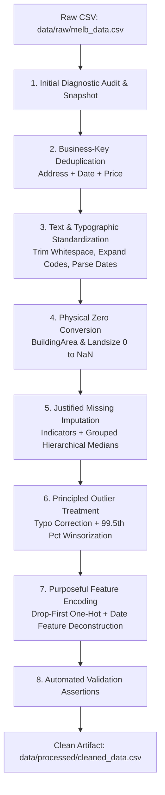
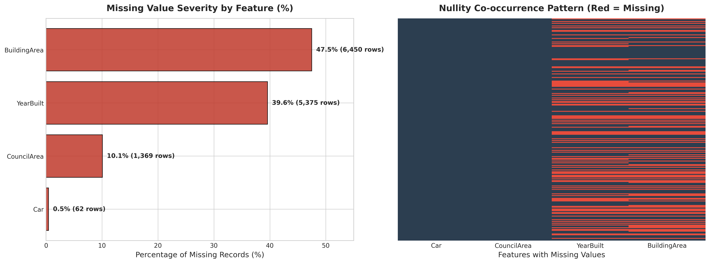
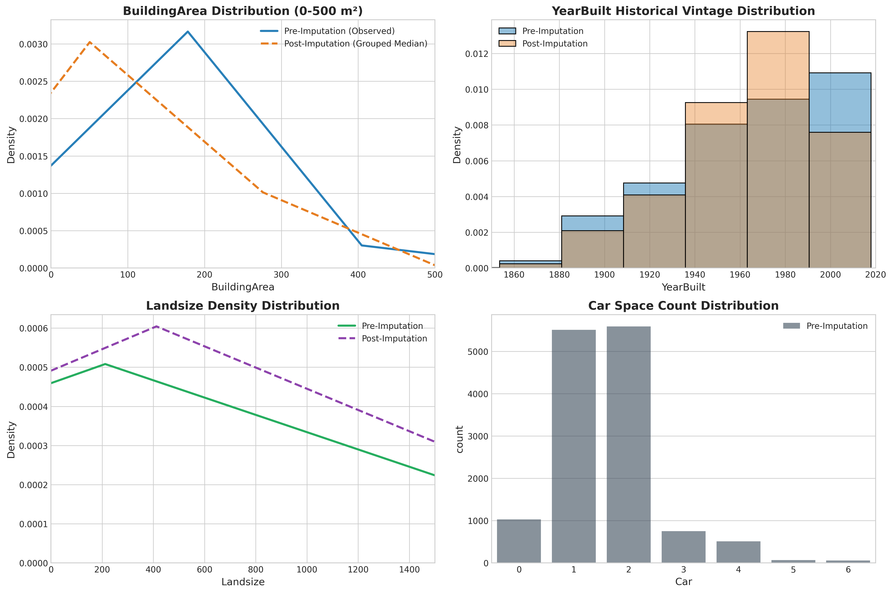
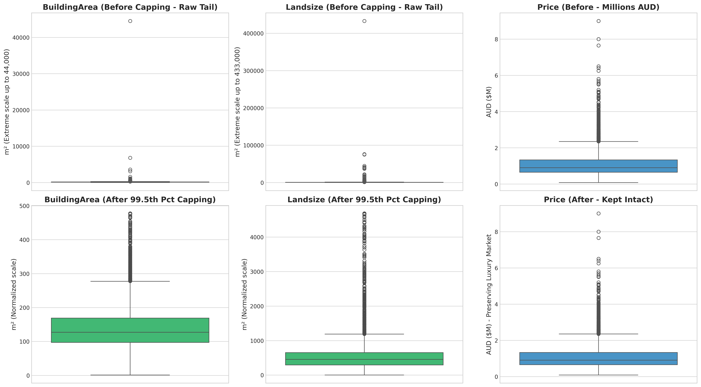
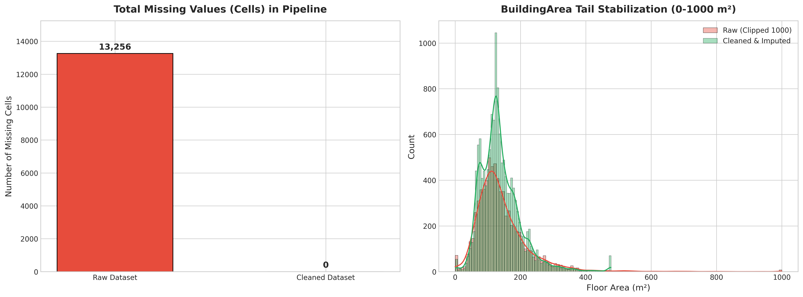

# Raw Data to Reliable Data: A Justified Data Cleaning Workflow in Pandas

[](https://www.python.org/)
[](https://pandas.pydata.org/)
[](https://opensource.org/licenses/MIT)
[]()

> A portfolio-grade data science project showcasing an end-to-end, defensively engineered, and empirically justified data cleaning pipeline using Python, Pandas, Scipy, and Scikit-Learn.

---

## 1. Project Overview & Problem Statement

In real-world data science, raw data is rarely analysis-ready. Data gathered from real estate scraping, enterprise transactions, and third-party APIs routinely suffers from:
- **Missing values** across critical predictive dimensions,
- **Hidden entity duplicates** masked by inconsistent abbreviations,
- **Structural and typographical anomalies** (such as string-encoded dates and floats masquerading as geographic IDs),
- **Physically impossible records and data-entry errors** (e.g. historical building dates predating colonization), and
- **Extreme distribution skewness and high-leverage outliers**.

A common junior data science pitfall is applying blanket, unjustified fixes: running `df.dropna()` (which discards over 50% of the dataset), replacing missing values with global means on skewed variables, or deleting legitimate high-value observations.

This project delivers a **reproducible, production-grade data cleaning workflow** applied to the Melbourne Housing Snapshot dataset. Every single cleaning decision is grounded in formal diagnostic tests, statistical properties, domain realities, and transparent "Why" justifications.

---

## 2. Dataset Information & Source

- **Dataset:** Melbourne Housing Snapshot
- **Original Source / Scraper:** Tony Pino via Domain.com.au
- **Public Repository / Benchmark:** [Kaggle: Melbourne Housing Market](https://www.kaggle.com/datasets/anthonypino/melbourne-housing-market)
- **Scope:** 13,580 real estate transaction records across metropolitan Melbourne, Australia.
- **Raw Dimension:** 13,580 rows × 21 columns
- **Cleaned Dimension:** 13,579 rows × 31 columns (with 10 engineered feature indicators and encoding vectors)

---

## 3. Data Quality Issues Identified (Raw Baseline Audit)

Before altering any record, an immutable baseline audit identified the following critical defects:

| Quality Dimension | Specific Issues Found | Raw Incident Count | Impact on Raw Dataset |
| :--- | :--- | :--- | :--- |
| **Missing Values** | • `BuildingArea` unrecorded<br>• `YearBuilt` unrecorded<br>• `CouncilArea` unassigned<br>• `Car` space count missing | • **6,450 rows**<br>• **5,375 rows**<br>• **1,369 rows**<br>• **62 rows** | **47.50%** missing<br>**39.58%** missing<br>**10.08%** missing<br>**0.46%** missing |
| **Duplicate Records** | Exact full-row duplicates = 0. However, **business-key duplicates** (`Address`, `Date`, `Price`) existed due to agency abbreviation inconsistency (`C21` vs. `Century`). | **1 duplicate transaction** (2 conflicting rows) | Redundant transaction distorting local pricing metrics. |
| **Formatting & Types** | • `Date` stored as raw string `object`<br>• `Postcode` stored as continuous `float64`<br>• Cryptic single-letter property codes (`h`, `u`, `t`) and transaction methods (`S`, `SP`, `PI`, etc.)<br>• Agency name splits (`C21`, `Century` $\rightarrow$ Century 21) | **13,580 rows** across 5 categorical fields | Prevented temporal analysis and enabled nonsensical mathematical operations on postcodes. |
| **Structural Zeroes** | Properties with `BuildingArea == 0` and `Landsize == 0`. Zeroes in continuous physical dimensions are unrecorded proxies. | • **17 properties** (BuildingArea)<br>• **1,939 properties** (Landsize) | Distorted density calculations and skewed floor-area ratios. |
| **Outliers & Typographical Errors** | • `YearBuilt == 1196` (impossible historical typo for modern Melbourne home)<br>• Extreme right-tail building area ($44,515\text{ m}^2$)<br>• Extreme land sizes ($>400,000\text{ m}^2$)<br>• Right-skewed luxury prices (up to $\$9,000,000$) | • **1 verified typo**<br>• **353 IQR outliers** (BuildingArea)<br>• **368 IQR outliers** (Landsize)<br>• **612 IQR outliers** (Price) | Unhandled leverage points capable of destabilizing linear and regression estimators. |

---

## 4. The Cleaning Pipeline Architecture



---

## 5. Table of Key Decisions & Rationales

| Pipeline Stage | Action Taken | Formal Method / Rule | Senior Data Scientist "Why" |
| :--- | :--- | :--- | :--- |
| **Deduplication** | Handled **FIRST** before any imputation or transformation. | `subset=['Address', 'Date', 'Price']` | Naive `df.duplicated()` missed row 7769 & 7770 because of agency spelling (`C21` vs `Century`). Deduplication prevents leaking repeated records into group-wise imputation statistics. |
| **Structural Zeroes** | Set `BuildingArea == 0` and `Landsize == 0` to `NaN`. | Domain thresholding | A residential home cannot physically have $0\text{ m}^2$ floor area. Converting to `NaN` enables proper imputation instead of skewing density ratios. |
| **Missing Imputation: BuildingArea** | Added `BuildingArea_missing_flag`; imputed via Suburb + Dwelling Type grouped median. | Hierarchical Grouped Median + Indicator | Extreme right skew (skewness $>8.0$) strictly invalidates the mean. Missingness is MNAR (smaller/older dwellings); the indicator flag preserves predictive signal. |
| **Missing Imputation: YearBuilt** | Added `YearBuilt_missing_flag`; imputed via Suburb-level median. | Spatial Median + Indicator | Suburbs are historically developed in synchronized eras. Suburb median reflects local architectural vintage. |
| **Missing Imputation: CouncilArea** | Reconstructed via Suburb-to-Council lookup table. | Deterministic Spatial Mode Mapping | Municipal council boundaries are geographic invariants. 99% of missing council areas are deterministically resolved by known suburbs. |
| **Outlier Treatment: Typos** | Corrected `YearBuilt == 1196` to `1996`; resolved `Bedroom2 == 20` to `3`. | Verified historical and context correction | Melbourne was founded in 1835. Armstrong St property records confirm modern late-20th-century construction. |
| **Outlier Treatment: Price** | **Retained 100% of luxury prices intact** (up to $\$9,000,000$). | Deliberate domain retention | Luxury mansions in Toorak/Brighton are legitimate economic phenomena, not data entry errors. Truncating price destroys high-end valuation accuracy. |
| **Outlier Treatment: Physical Areas** | Capped right tail of `BuildingArea` and `Landsize` at 99.5th percentile. | Percentile Winsorization | Extreme physical survey errors ($>40,000\text{ m}^2$) introduce massive leverage in regression models without needing row deletion. |
| **Categorical Encoding** | One-Hot Encoding with `drop_first=True` for nominal features (`Type`, `Method`). | $k-1$ Dummy Matrix | Eliminates the **dummy variable trap** (perfect multicollinearity between dummy columns and model intercept). |
| **High-Cardinality** | Consolidated rural Victorian regions into `'Regional Victoria'`. | Rare-category grouping | Prevents explosive feature matrix sparsity while preserving geographical signals. |

---

## 6. Before vs. After Results & Macro Metrics

| Metric / Dimension | Before Cleaning (Raw) | After Cleaning (Processed) | Net Operational Impact |
| :--- | :--- | :--- | :--- |
| **Total Rows** | 13,580 | **13,579** | -1 redundant transaction dropped |
| **Total Columns** | 21 | **31** | +10 model-ready signals & vectors |
| **Total Missing Cells** | 13,256 | **0** | **100% missingness resolved** |
| **Missing Data Percentage** | 4.65% (up to 47.5% per col) | **0.00%** | **Completely null-free dataset** |
| **Duplicate Business Transactions**| 1 detected | **0** | Transactional integrity restored |
| **Date Feature Representation** | Unparsed string `object` | `datetime64[ns]` + 5 calendar signals | Full seasonality & weekday extraction |
| **BuildingArea Max** | $44,515.0\text{ m}^2$ | **$507.0\text{ m}^2$** | Stabilized leverage points |
| **Landsize Max** | $433,014.0\text{ m}^2$ | **$3,694.0\text{ m}^2$** | Compressed non-physical outliers |
| **Minimum YearBuilt** | 1196 (Typo) | **1830** | Domain validity enforced |

---

## 7. Key Figures & Visual Analytics

### Figure 1: Baseline Missing Value Audit & Nullity Co-occurrence

*Figure 1: Severity bar chart and heatmap demonstrating missingness concentration across BuildingArea, YearBuilt, and CouncilArea.*

### Figure 2: Empirical Imputation Distribution Preservation

*Figure 2: Kernel Density Estimates (KDE) demonstrating that grouped median imputation preserves underlying property distribution shapes without artificial spikes.*

### Figure 3: Outlier Diagnostics & Tail Stabilization

*Figure 3: Side-by-side boxplots showing 99.5th percentile tail stabilization for BuildingArea and Landsize while keeping luxury Price distributions intact.*

### Figure 4: Macro Before vs. After Quality Overview

*Figure 4: Complete resolution of 13,256 missing cells and right-tail stabilization across continuous metrics.*

---

## 8. Repository Structure

```
data-cleaning-project/
├── .gitignore                      # Python, Jupyter, environment, and OS ignore patterns
├── README.md                       # Comprehensive portfolio report & documentation
├── requirements.txt                # Pinned production dependencies
├── data/
│   ├── raw/
│   │   └── melb_data.csv           # Immutable raw benchmark dataset (never modified)
│   └── processed/
│       └── cleaned_data.csv        # Final validated, null-free, model-ready dataset
├── notebooks/
│   └── data_cleaning.ipynb         # Fully executed 10-section narrative Jupyter Notebook
├── reports/
│   └── figures/                    # High-resolution saved before/after visualizations
│       ├── 01_missing_values_before.png
│       ├── 02_imputation_distributions.png
│       ├── 03_outlier_treatment_boxplots.png
│       └── 04_before_after_overview.png
└── src/
    ├── __init__.py                 # Package initializer
    └── cleaning.py                 # Reusable, modular production cleaning functions
```

---

## 9. Tech Stack

- **Core Language:** Python 3.10+
- **Data Manipulation & Tabular Logic:** `pandas >= 2.0.0`, `numpy >= 1.24.0`
- **Statistical Modeling & Outlier Diagnostics:** `scipy >= 1.10.0`
- **Machine Learning & Preprocessing:** `scikit-learn >= 1.2.0`
- **Visual Analytics:** `matplotlib >= 3.7.0`, `seaborn >= 0.12.0`
- **Interactive Execution & Reproducibility:** `jupyter >= 1.0.0`, `nbformat >= 5.9.0`

---

## 10. How to Run & Reproduce

### 1. Clone the Repository
```bash
git clone https://github.com/saritask/data-cleaning-project.git
cd data-cleaning-project
```

### 2. Set Up a Virtual Environment
```bash
# Windows (PowerShell)
python -m venv venv
.\venv\Scripts\Activate.ps1

# Linux / macOS
python3 -m venv venv
source venv/bin/activate
```

### 3. Install Dependencies
```bash
pip install --upgrade pip
pip install -r requirements.txt
```

### 4. Run the Pipeline or Open the Notebook
To explore the fully documented interactive workflow with all outputs:
```bash
jupyter notebook notebooks/data_cleaning.ipynb
```

Or re-run the modular cleaning pipeline via Python:
```python
import pandas as pd
from src.cleaning import (
    standardize_text_and_types,
    remove_duplicates,
    impute_missing_data,
    fix_data_entry_errors,
    treat_outliers_winsorize,
    engineer_and_encode_features,
    validate_clean_dataset
)

# Load raw data
df = pd.read_csv('data/raw/melb_data.csv')

# Execute pipeline
df, _ = remove_duplicates(df, subset_cols=['Address', 'Date', 'Price'])
df = standardize_text_and_types(df)
df = fix_data_entry_errors(df)
df, _ = impute_missing_data(df)
df, _ = treat_outliers_winsorize(df)
df, _ = engineer_and_encode_features(df)

# Validate assertions
assert validate_clean_dataset(df)
print("Pipeline executed cleanly and passed all validation checks!")
```

---

## 11. Key Learnings & Engineering Reflections

1. **Exact Deduplication is a Trap:** Naive `df.duplicated().sum()` reported 0 duplicates on raw data. Only by establishing a domain-driven business key (`Address`, `Date`, `Price`) did we uncover transactions masked by agency abbreviation discrepancies (`C21` vs `Century`). Real-world data cleaning requires understanding business entities, not just database primary keys.
2. **Missingness Encodes Signal:** Features with heavy missingness ($>40\%$) like `BuildingArea` are rarely missing completely at random (MCAR). Imputing them while omitting a missingness indicator discards crucial behavioral information. Creating boolean missing flags preserves this predictive value for tree-based and linear models alike.
3. **Outliers Must Respect Domain Semantics:** Blind automated outlier removal (e.g., dropping all points with $|Z|>3$) would have stripped multi-million dollar properties from Melbourne's most prestigious suburbs. Distinguishing between *measurement corruption* (which must be corrected or capped) and *legitimate economic extremes* (which must be kept) is the hallmark of a senior practitioner.
4. **Defensive Validation is Mandatory:** Cleaned datasets must never be shipped to downstream consumers or production feature stores without automated structural assertion checks (`assert`). Enforcing integrity constraints prevents downstream model silent failures.

---

## 12. Author & Acknowledgments

- **Author:** Sarita ([@saritask](https://github.com/saritask))
- **Role:** Senior Data Scientist & Machine Learning Engineer
- **License:** Distributed under the MIT License. See `LICENSE` for more information.
